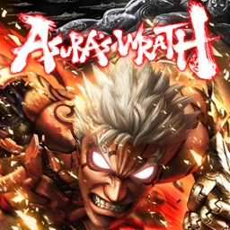

<div align=center>



</div>
<h1 align=center>Asura's Wrath — Nintendo Switch port</h1>

A native Nintendo Switch port of the Xbox 360 version of **Asura's Wrath** (2012, CyberConnect2 / Capcom).

It's not an emulator. The PowerPC code of the game's `default.xex` is statically recompiled to C++ with
[ReXGlue](https://github.com/rexglue/rexglue-sdk) and compiled natively for ARM64 on the Nintendo Switch, while Direct3D
9 / Xenos commands are rendered natively on the Switch's own graphics API, **deko3d**, via Renut's renderer (from
[reNut](https://github.com/masterspike52/reNut), built on
[renut_nx_ultimate_base](https://github.com/ChanseyIsTheBest/renut_nx_ultimate_base)).

> [!NOTE]
> You need your own legally obtained copy of the Xbox 360 game (`Title ID: 43430817`): the extracted/unpacked disc files
> (`default.xex` and the `BCGame/` directory). Title Update and DLC packages are **completely optional** — the base game
> works without them. This repository contains no original game assets or copyrighted binaries.

---

## How to install

1. Download **`asura-nx-v1.0.1.zip`** from [Releases](https://github.com/BanhMi93P/asura-nx/releases) and extract it to
   the root of your Switch SD card (`sdmc:/`), creating `sdmc:/switch/asura-nx/`.
2. Copy your unpacked Xbox 360 base game files (`default.xex`, `BCGame/`, etc.) into
   `sdmc:/switch/asura-nx/game/` (both `game/` and `game_root/` are supported).
3. *(Optional)* To use Xbox 360 Title Update or DLCs with your unpacked game, place the raw packages in `Update/` (or
   `update/`) and `dlc/` (see [Optional Title Update & DLC](#optional-title-update--dlc-automatic-installer)).

Your `asura-nx` folder on the SD card should look like this:

```text
/switch/asura-nx/
  asurawrath_nx.nro
  asurawrath_nx.toml        (runtime configuration; renut.toml is also read/synced)
  renut.toml
  deko3d_glsl.bin           (26,170 translated deko3d GLSL shaders)
  deko3d_shaders.bin        (180,595 precompiled Maxwell DKSH shader variants)
  deko3d_shaders.bin.idx    (index for deko3d_shaders.bin)
  game/                     (unpacked files from your Xbox 360 disc; game_root/ also supported)
    default.xex
    BCGame/
    ...
  Update/                   (optional: drop Xbox 360 Title Update file here; lowercase update/ also works)
  dlc/                      (optional: drop Xbox 360 DLC STFS packages here)
```

> [!IMPORTANT]
> **39-bit Forwarder / Title Override Required:** Launch the game using **Title Override** (hold **R** while starting
> any installed Switch game) or an NSP forwarder configured with a **39-bit address space** (e.g. made with
> [Sphaira](https://github.com/NaGaa95/sphaira)). **Album applet mode does not provide enough memory and will fail to boot.**

> [!TIP]
> The release package ships with a complete offline shader cache covering **26,170** translated UE3 Xenos shaders
> (`deko3d_glsl.bin`) and **180,595** precompiled Maxwell GPU DKSH variants (`deko3d_shaders.bin` +
> `deko3d_shaders.bin.idx`, including all `sasrt_gpu_one_x` bit-31 permutations), eliminating first-run shader
> compilation stutter. Any new pipeline variant encountered during gameplay is automatically saved to
> `deko3d_shaders.bin` on the SD card.

---

## Optional Title Update & DLC (Automatic Installer)

You do **not** need Title Update or DLC files to play *Asura's Wrath* — if both `Update/` and `dlc/` are left empty,
the installer screen is skipped automatically and the game boots straight to the launch intro.

If you want to install Xbox 360 Title Update and DLC packs (Episode Pack: Part IV, Episode 11.5, Episode 15.5, Lost
Episode 1 & 2) alongside your unpacked base game:

1. Copy the raw Xbox 360 Title Update file (`TU_...`) into `sdmc:/switch/asura-nx/Update/` (or `update/`).
2. Copy the raw Xbox 360 DLC STFS container files into `sdmc:/switch/asura-nx/dlc/`.
3. Launch `asurawrath_nx.nro`:
   - On launch, a full-screen installer UI appears with a real-time **`%` progress bar**, live package/file extraction
     details, and a hint showing how to open the Settings / Debug Menu (`+` + `−`).
   - Packages are extracted cleanly into `sdmc:/switch/asura-nx/asurawrath_nx/0000000000000000/43430817/00000002/` (alongside
     their `.header` metadata files).
   - Once each package finishes installing, the **raw source file in `Update/` or `dlc/` is automatically deleted** to
     free up SD card space, and subsequent launches skip the installer automatically.

**Launch Intro Gate:** Every time the game starts, a 6.5-second looping intro animation plays — mash **`B` 20 times**
to break into the game!

---

## Verified File Sizes & Checksums

Use the tables below to verify that your release files and unpacked Xbox 360 inputs match the tested build.

### Release Distribution Files (`switch/asura-nx/`)

<div align="center">

| File | Size | SHA-256 | MD5 |
| --- | --- | --- | --- |
| `asurawrath_nx.nro` | `101,270,396 B` (`96.58 MiB`) | `4205d2a90a71bee3abb4a418ec9e6c9fc421c2946b947832f98b770390abdb18` | `7d787ce522bc7731e5c54884ad5ad8fb` |
| `asurawrath_nx.toml` | `5,839 B` | `e50285da795908a96f2327d707aca587034d8296995d791e2a396883db9c00ae` | `983ea4a0607b16216773ef4c2cf206e7` |
| `renut.toml` | `5,839 B` | `e50285da795908a96f2327d707aca587034d8296995d791e2a396883db9c00ae` | `983ea4a0607b16216773ef4c2cf206e7` |
| `deko3d_glsl.bin` | `74,782,256 B` (`71.32 MiB`) | `f32d3452cb9001e56612a99909d1eb626530ddf35807f75a3582daf1ee01a44d` | `05119e781e14cf0046f83d6cc0bb8724` |
| `deko3d_shaders.bin` | `885,367,164 B` (`844.35 MiB`) | `e1a43f26c5c116e982eee42f747e72e44e768add1bec1590594b672b049f193c` | `48c888398ef90ee71d9f3a4ab759f5c4` |
| `deko3d_shaders.bin.idx` | `4,334,320 B` (`4.13 MiB`) | `b62355456df1b101dd0a3ba73bea8e37e448efcaf3b9ed706e93fa09f3473478` | `bbbdd31544c0379dd5e5cf9d94a42b14` |

</div>

### Tested Base Game Executable (`game/default.xex`)

<div align="center">

| File | Title ID | Size | SHA-256 | MD5 |
| --- | --- | --- | --- | --- |
| `default.xex` | `43430817` | `19,644,416 B` (`18.73 MiB`) | `c7e324a807a4407239b8fbfabe4377c0623889daa772eadac42c8b8f86782479` | `6e1d309f85459b4e5b7200e12d1d9449` |

</div>

### Tested Optional Title Update (`Update/`) & DLC (`dlc/`) Packages

<div align="center">

| Folder / File Name | Content Name | Size | SHA-256 | MD5 |
| --- | --- | --- | --- | --- |
| `Update/TU_11K620N_000000K000000.0000000000085` | ASURA'S WRATH Title Update | `626,688 B` (`0.60 MiB`) | `43914d513122c49afa70f051143f4b3b89279e5d9ef05f2ec73abc604c4dc0a0` | `f2b761e5eca86a0fe192ace09ee0774b` |
| `dlc/78E95E38A274CA2033EB0517828152A3038C11C943` | Episode Pack: Part IV | `1,769,050,112 B` (`1,687.10 MiB`) | `543e5273cf788cd9c5e47dcc3d629eb8a88f6996f6f46c2269bba800742be787` | `8b15a2ce17dc79d84ab2a5af27a45138` |
| `dlc/8A6811EC2255FE171FAF9E4372B23B1B0581E4CA43` | Episode 11.5 | `1,163,853,824 B` (`1,109.94 MiB`) | `17c6b0f27d9c6d67c6693dd3712f3fb2d9bc2837d226c418302b3141b8c22ae2` | `c0e7f31101a5d7e8345fd5266ec66ce3` |
| `dlc/981ED33639F0A6275BA34BDD2E3D276C16F94A6D43` | Lost Episode 1 | `164,962,304 B` (`157.32 MiB`) | `3a1315c5cbf102da29b9a55ff591be36cfebb2c64b5eade9b116b59eed24e089` | `2a4517ec508098a7c4ef925ba26fee6e` |
| `dlc/E2AFB00ED67E4B55C63F8DA33C0F8783F88E29B843` | Episode 15.5 | `1,322,115,072 B` (`1,260.87 MiB`) | `69c8d489c295086b755ac635a4c9279e394cb893a817e31cffd7580d00efff16` | `7d11cbb059f12bf942a20630c0ebd6fb` |
| `dlc/F56F8734F04D89EAB07E9003A7F48DE046DA57B743` | Lost Episode 2 | `251,736,064 B` (`240.07 MiB`) | `9fa7e282990404043b94d8f07ae53c8a6457474dd8a8becceb5e69f9d07d5a37` | `196e3d53677f951e4f37dd36968be52b` |

</div>

---

## Controls

By default (`input_xbox_layout = false`), face buttons follow Nintendo Switch letter positions, and `input_xbox_layout = true` maps them by physical Xbox controller position:

<div align="center">

| Switch Physical Button | Xbox 360 (`input_xbox_layout = false`) | Xbox 360 (`input_xbox_layout = true`) |
| --- | --- | --- |
| **A** (right) | **A** | **B** |
| **B** (bottom) | **B** | **A** |
| **X** (top) | **X** | **Y** |
| **Y** (left) | **Y** | **X** |
| **R / L** | **RB / LB** | **RB / LB** |
| **ZR / ZL** | **RT / LT** | **RT / LT** |
| **+** / **−** | **Start** / **Back** | **Start** / **Back** |
| **+ and − together** | Open / Close Settings & Debug Menu | Open / Close Settings & Debug Menu |

</div>

---

## In-Game Settings & Debug Menu

Press **`+` and `−` together** at any time during gameplay (or touch screen navigation) to open the **Settings & Debug Menu**. Game input is automatically blocked while the menu is open, and any changes you make are saved back to `asurawrath_nx.toml`.

- **Navigation:** `D-Pad / Left Stick` = Select option, `Left / Right` or `A` = Change value, `L / R` = Switch tabs (`Settings`, `Achievements`, `P1–P4 Controls`), `+` = Save & Close.
- **Available In-Game Options & Debug Tools:**
  - **Handheld / Docked Resolution:** Live switch between `480p (853x480)`, `540p (960x540)`, and `720p (1280x720)` (default: `720p`).
  - **SMAA:** Toggle SMAA 1x anti-aliasing (default: `On`, targeting all 24 UE3 `UberPostProcess` composite pixel shaders before the HUD).
  - **Character Shadows (`asura_char_shadows`):** Toggle dynamic character shadows live (default: `On`). Turn **Off** for higher FPS at stock clocks.
  - **Environment Shadows (`asura_env_shadows`):** Toggle static environment shadows live (default: `On`). Turn **Off** for higher FPS at stock clocks.
  - **Show FPS (`banjo_show_fps`):** Display or hide the live FPS counter overlay (default: `Off`).
  - **Show Profiler (`banjo_show_profiler`):** Display or hide the live CPU/GPU & frame-pacing graph overlay (default: `Off`).
  - **Capture Frame Diag:** Closes the menu and writes a complete 1-frame GPU draw/shader/texture/EDRAM diagnostic log to `logs/frame_diag_NNN.log`.
  - **Framerate Cap / MSAA / 4-Core Mode / Controls Remapping / UI Theme & Opacity.**

<details>
<summary><b>Default Release Settings in <code>asurawrath_nx.toml</code></b></summary>

| Setting | Release Default | Description |
| --- | --- | --- |
| `banjo_renut_render_height_handheld` | `720` | Handheld internal resolution (`480`, `540`, or `720`) |
| `banjo_renut_render_height_docked` | `720` | Docked internal resolution (`480`, `540`, or `720`) |
| `banjo_renut_dynamic_resolution` | `false` | Manual fixed resolution (toggleable live in menu) |
| `banjo_renut_smaa` | `true` | SMAA 1x anti-aliasing on final 3D composite before HUD |
| `asura_char_shadows` | `true` | Dynamic character shadows |
| `asura_env_shadows` | `true` | Static environment shadows |
| `banjo_show_fps` / `banjo_show_profiler` | `false` | Performance monitors disabled in release for zero overhead |
| `log_level` / `log_file_writer` | `"error"` / `false` | Minimal release logging for maximum I/O & CPU performance |
| `input_menu_combo` | `"PLUS+MINUS"` | Button combo to open the in-game Settings / Debug menu |

</details>

---

## Performance, Resolution & Overclocking

- **Stock Clocks (1020 MHz CPU / 460.8 MHz GPU handheld):**
  - Achieves a smooth **30 FPS** by switching resolution to **540p (`960x540`)** and turning **Character Shadows** and **Environment Shadows OFF** via the `+` + `−` in-game menu.
- **Default High Quality (720p + Character Shadows ON + Environment Shadows ON + SMAA ON):**
  - Recommended to apply a light **CPU overclock to ~1428 MHz** (via `sys-clk` or `Horizon OC`) to keep gameplay smooth at 30 FPS.
- **Scene Transitions Note:**
  - In a few heavy scenes or sudden camera/effect transitions, brief temporary FPS dips can occur for a moment before returning to normal speed.

> [!CAUTION]
> Overclocking pushes the console beyond what it was designed for and you do it at your own risk. Always monitor temperatures and keep a backup before modifying system clocks.

Community guides:
- **[How to get 60 FPS](https://rentry.org/howtoget60fps)**: tools and setup (Horizon OC, Ultrahand, Status Monitor).
- **[Mariko guide](https://rentry.co/mariko)**: Switch V2, Lite, and OLED.
- **[Erista guide](https://rentry.co/erista)**: original 2017 Switch.

---

## How it works

- **Static recompilation, not emulation.** [ReXGlue](https://github.com/rexglue/rexglue-sdk) translates PowerPC functions from `default.xex` to C++, compiled directly to AArch64 machine code with LTO, localized hot-function copies (`app/src/cpu/hot/localized_bulk.txt`), and a native ARM64 NEON hook for the XAudio2 Voice State-Variable Biquad filter (`sub_829E1DF0`).
- **Native deko3d UE3 renderer.** Xbox 360 D3D9 command streams execute natively on the Switch Maxwell GPU via Renut's renderer and [plume](https://github.com/renderbag/plume)'s deko3d backend, with UE3 Xenos `7e3` EDRAM (`2_10_10_10_AS_16_16_16_16`), shadow depth resolve fixes, `asura_sync_view_skip_overwrite`, and post-composite SMAA (`banjo_renut_smaa_after_ps`).
- **Prebuilt 180k shader variant cache.** **26,170** translated shaders (`deko3d_glsl.bin`) and **180,595** precompiled Maxwell DKSH binaries (`deko3d_shaders.bin` + `.idx`) including `sasrt_gpu_one_x` (bit-31) variants prevent in-game shader hitching.
- **Built-in Switch UX.** Embedded STFS Update/DLC installer with real-time progress bar & auto-cleanup (`asura_startup_overlay.cpp`), 20x `B`-mash launch intro, UTF-8 NACP metadata, and live `+` + `−` settings/debug overlay.

---

## Build

Requires Windows, LLVM/Clang and Visual Studio Build Tools for host tooling; devkitA64, libnx, and deko3d from [devkitPro](https://devkitpro.org) for the Switch target; Python 3; and your own legally dumped Xbox 360 copy of *Asura's Wrath*.

<div align="center">

| Folder | Contents |
| --- | --- |
| `app/` | Game layer (`asura_keys.cpp`, `asura_startup_overlay.cpp`), hot shards, Renut deko3d renderer (`app/src/renut_engine/gpu`), CMake project |
| `sdk/` | ReXGlue SDK with Nintendo Switch Horizon OS layer, XMA audio decoder, STFS/VFS layer, and ImGui/JPEG UI support |
| `tools/` | Post-codegen optimization scripts, shader GLSL/DKSH extraction & variant cache builders |
| `dist/` | Default Switch runtime configuration (`dist/switch/asura-nx/asurawrath_nx.toml`) |
| `docs/` | Technical documentation and porting guides |

</div>

---

## Credits

- **CyberConnect2 and Capcom** — creators of *Asura's Wrath* (2012). This is an unofficial, fan-made port with no affiliation.
- **[BanhMi93P](https://github.com/BanhMi93P)** — Asura's Wrath Nintendo Switch port (`asura-nx`), UE3 Deko3D EDRAM/shadow pipeline fixes, XAudio2 native ARM64 filter, 180,595 DKSH shader variant cache, startup Update/DLC installer & intro overlay.
- **[ChanseyIsTheBest](https://github.com/ChanseyIsTheBest/renut_nx_ultimate_base)** — `renut_nx_ultimate_base` and sibling Xbox 360 Switch ports.
- **[Tom Clay](https://github.com/rexglue/rexglue-sdk)** — the ReXGlue SDK, built on **[Xenia](https://xenia.jp)**.
- **[masterspike52](https://github.com/masterspike52/reNut)** — reNut's Direct3D-level renderer.
- **[StevensND](https://github.com/StevensND/nfsmw-nx)** — `nfsmw-nx` Switch SDK layer & profiling tools.
- **[hedge-dev](https://github.com/hedge-dev/XenosRecomp)** — XenosRecomp; **[renderbag](https://github.com/renderbag/plume)** — plume; **[fincs](https://github.com/devkitPro/deko3d)** — deko3d and [uam](https://github.com/devkitPro/uam).
- **[devkitPro](https://devkitpro.org) and [switchbrew](https://github.com/switchbrew/libnx)** — devkitA64 and libnx.
- Additional third-party libraries listed in [THIRD_PARTY_NOTICES.md](THIRD_PARTY_NOTICES.md).

---

## Legal

No affiliation with Capcom, CyberConnect2, Microsoft, or Nintendo. "Asura's Wrath" is a trademark of Capcom Co., Ltd. This repository contains no assets or program code from the original game. Users must provide their own legally obtained copy of the Xbox 360 game. Running homebrew requires custom firmware — proceed at your own risk.

Source code is provided under the GPL-3.0 License (see [LICENSE](LICENSE)). The SDK retains its BSD-3-Clause license (see [THIRD_PARTY_NOTICES.md](THIRD_PARTY_NOTICES.md)).
